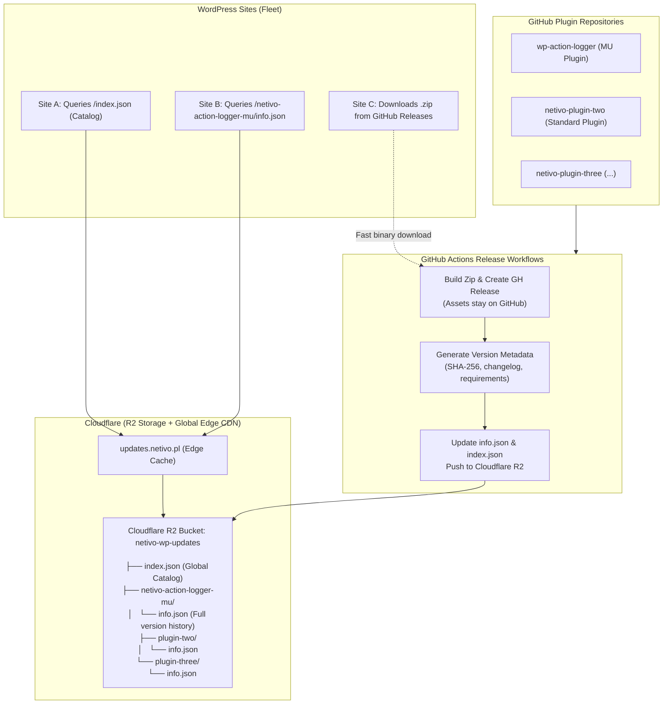

# Netivo WordPress Plugin Repository on Cloudflare

## 1. Architectural Overview & System Concept

This document defines the architecture and implementation plan for a **centralized, serverless WordPress plugin repository** hosted on **Cloudflare R2 and Cloudflare CDN** (`updates.netivo.pl`).

Rather than serving only single-plugin update checks, this repository functions as a multi-plugin catalog (similar to WordPress.org, Composer Packagist, or an internal registry) that scales to an arbitrary number of Netivo plugins.

### Key Tenets:
1. **Catalog at Root (`/` or `/index.json`)**: Visiting the repository root returns a global JSON catalog of all Netivo plugins, their descriptions, latest versions, and individual endpoints.
2. **Version History Per Plugin (`/<slug>/info.json`)**: Opening any plugin directory exposes complete version history (current release + all historical versions), enabling version pinning, rollbacks, and full changelogs.
3. **No Binary ZIP Storage on Cloudflare**: Binary release `.zip` assets remain hosted on GitHub Releases (`github.com/<org>/<repo>/releases/download/...`). Downloads are served directly via GitHub's CDN/AWS S3 without hitting GitHub's 60 req/hr API rate limits. Cloudflare R2 stores only metadata JSON manifests and documentation.
4. **Automated CI/CD Publishing**: Any plugin's GitHub Actions release workflow automatically pushes new version metadata and updates both the plugin manifest and the global catalog in R2.



---

## 2. Cloudflare Repository Layout & URL Endpoints

Domain: `https://updates.netivo.pl`

| Endpoint | Purpose | Description |
|---|---|---|
| `GET /` or `GET /index.json` | Global Catalog | Returns an index of all registered Netivo plugins, their latest releases, metadata, and links. |
| `GET /<slug>/info.json` | Plugin Manifest & Archive | Full metadata for a specific plugin, including `latest` pointer and `versions` map of all past releases. |
| `GET /<slug>/` | Plugin Directory Root | Aliased / redirected to `/<slug>/info.json`. |

### Cloudflare R2 Storage Hierarchy:
```text
netivo-wp-updates (R2 Bucket)
├── index.json                                  # Global catalog of all Netivo plugins
├── netivo-action-logger-mu/
│   └── info.json                              # Full version history + latest release
├── netivo-crm-sync/
│   └── info.json
├── netivo-seo-optimizer/
│   └── info.json
└── netivo-ecommerce-tools/
    └── info.json
```

---

## 3. JSON Data Schemas

### 3.1 Global Catalog Schema (`/index.json`)
Served at the root of the repository. Allows dashboards, fleet managers, or custom WP CLI commands to discover all Netivo plugins.

```json
{
  "$schema": "https://updates.netivo.pl/schemas/repository.v1.json",
  "name": "Netivo WordPress Plugin Repository",
  "homepage": "https://netivo.pl",
  "updated_at": "2026-11-07T15:30:00Z",
  "plugins": {
    "netivo-action-logger-mu": {
      "name": "Netivo Action Logger (MU)",
      "type": "mu-plugin",
      "latest_version": "0.7.0",
      "latest_tag": "v0.7.0",
      "requires_php": "8.2",
      "requires_wp": "6.3",
      "description": "High-performance audit logging for WordPress administration.",
      "manifest_url": "https://updates.netivo.pl/netivo-action-logger-mu/info.json",
      "last_updated": "2026-11-07T15:30:00Z"
    },
    "netivo-crm-sync": {
      "name": "Netivo CRM Connector",
      "type": "standard-plugin",
      "latest_version": "1.2.0",
      "latest_tag": "v1.2.0",
      "requires_php": "8.2",
      "requires_wp": "6.2",
      "description": "Bidirectional synchronization between WordPress and internal CRM.",
      "manifest_url": "https://updates.netivo.pl/netivo-crm-sync/info.json",
      "last_updated": "2026-11-05T10:15:00Z"
    }
  }
}
```

---

### 3.2 Plugin Versioned Manifest Schema (`/<slug>/info.json`)
Served at `/<slug>/info.json`. Contains full release history, current latest pointer, and cryptographic checksums for every version.

```json
{
  "$schema": "https://updates.netivo.pl/schemas/plugin.v1.json",
  "slug": "netivo-action-logger-mu",
  "name": "Netivo Action Logger (MU)",
  "type": "mu-plugin",
  "homepage": "https://netivo.pl",
  "repository": "https://github.com/netivo/wp-action-logger",
  "latest": "0.7.0",
  "updated_at": "2026-11-07T15:30:00Z",
  "versions": {
    "0.7.0": {
      "version": "0.7.0",
      "tag": "v0.7.0",
      "released_at": "2026-11-07T15:30:00Z",
      "requires_php": "8.2",
      "requires_wp": "6.3",
      "tested_wp": "6.7",
      "download_url": "https://github.com/netivo/wp-action-logger-plugin/releases/download/v0.7.0/netivo-action-logger-mu-v0.7.0.zip",
      "checksum": {
        "type": "sha256",
        "value": "7f8b9d3e4a5c6d7e8f9a0b1c2d3e4f5a6b7c8d9e0f1a2b3c4d5e6f7a8b9c0d1e",
        "url": "https://github.com/netivo/wp-action-logger-plugin/releases/download/v0.7.0/netivo-action-logger-mu-v0.7.0.zip.sha256"
      },
      "changelog": "- Switched update delivery to Cloudflare CDN repository.\n- Fixed GitHub API 60 req/hr rate limit bottleneck."
    },
    "0.6.2": {
      "version": "0.6.2",
      "tag": "v0.6.2",
      "released_at": "2026-11-06T12:00:00Z",
      "requires_php": "8.2",
      "requires_wp": "6.3",
      "tested_wp": "6.6",
      "download_url": "https://github.com/netivo/wp-action-logger-plugin/releases/download/v0.6.2/netivo-action-logger-mu-v0.6.2.zip",
      "checksum": {
        "type": "sha256",
        "value": "3c4d5e6f7a8b9c0d1e7f8b9d3e4a5c6d7e8f9a0b1c2d3e4f5a6b7c8d9e0f1a2b",
        "url": "https://github.com/netivo/wp-action-logger-plugin/releases/download/v0.6.2/netivo-action-logger-mu-v0.6.2.zip.sha256"
      },
      "changelog": "- Added runtime error collection."
    }
  }
}
```

---

## 4. GitHub Actions Release Publisher Workflow

This step runs in the CI/CD of each plugin repository whenever a new version tag (`v*.*.*`) is pushed. It updates both the plugin's `info.json` and the repository's `index.json` in Cloudflare R2 without storing any binary `.zip` files in R2.

### 4.1 Required GitHub Secrets
Configure once at the GitHub Organization level (or per repository):
- `CLOUDFLARE_R2_ACCOUNT_ID`
- `CLOUDFLARE_R2_ACCESS_KEY_ID`
- `CLOUDFLARE_R2_SECRET_ACCESS_KEY`
- `CLOUDFLARE_R2_BUCKET_NAME` (e.g. `netivo-wp-updates`)
- `CLOUDFLARE_ZONE_ID` (for edge cache purge)
- `CLOUDFLARE_API_TOKEN` (for edge cache purge)

### 4.2 GitHub Actions Job Definition
Add this job step to `.github/workflows/split-wp-mu-plugin.yml` (and other plugin release workflows):

```yaml
      - name: Publish Metadata to Cloudflare Plugin Repository
        if: ${{ startsWith(github.ref, 'refs/tags/') }}
        env:
          AWS_ACCESS_KEY_ID: ${{ secrets.CLOUDFLARE_R2_ACCESS_KEY_ID }}
          AWS_SECRET_ACCESS_KEY: ${{ secrets.CLOUDFLARE_R2_SECRET_ACCESS_KEY }}
          AWS_DEFAULT_REGION: auto
          R2_ENDPOINT: "https://${{ secrets.CLOUDFLARE_R2_ACCOUNT_ID }}.r2.cloudflarestorage.com"
          BUCKET: ${{ secrets.CLOUDFLARE_R2_BUCKET_NAME }}
          CF_ZONE_ID: ${{ secrets.CLOUDFLARE_ZONE_ID }}
          CF_API_TOKEN: ${{ secrets.CLOUDFLARE_API_TOKEN }}
        run: |
          set -euo pipefail
          SLUG="netivo-action-logger-mu"
          NAME="Netivo Action Logger (MU)"
          TYPE="mu-plugin"
          VERSION="${GITHUB_REF_NAME#v}"
          ZIP_NAME="netivo-action-logger-mu-${GITHUB_REF_NAME}.zip"
          SHA256=$(sha256sum "${GITHUB_WORKSPACE}/${ZIP_NAME}" | awk '{print $1}')
          NOW=$(date -u +"%Y-%m-%dT%H:%M:%SZ")

          DOWNLOAD_URL="https://github.com/netivo/wp-action-logger-plugin/releases/download/${GITHUB_REF_NAME}/${ZIP_NAME}"
          CHECKSUM_URL="https://github.com/netivo/wp-action-logger-plugin/releases/download/${GITHUB_REF_NAME}/${ZIP_NAME}.sha256"

          # 1. Download existing info.json from R2 if present, or initialize empty structure
          if aws s3 cp "s3://${BUCKET}/${SLUG}/info.json" ./current_info.json --endpoint-url "${R2_ENDPOINT}" 2>/dev/null; then
            echo "Loaded existing info.json for ${SLUG}"
          else
            echo "Initializing new info.json for ${SLUG}"
            echo '{"slug":"'${SLUG}'","name":"'${NAME}'","type":"'${TYPE}'","latest":"","updated_at":"","versions":{}}' > ./current_info.json
          fi

          # 2. Append new version entry and update 'latest' pointer using jq
          jq --arg v "$VERSION" \
             --arg tag "$GITHUB_REF_NAME" \
             --arg now "$NOW" \
             --arg dl "$DOWNLOAD_URL" \
             --arg sha "$SHA256" \
             --arg sha_url "$CHECKSUM_URL" \
             '
             .name = "'"${NAME}"'" |
             .type = "'"${TYPE}"'" |
             .latest = $v |
             .updated_at = $now |
             .versions[$v] = {
               version: $v,
               tag: $tag,
               released_at: $now,
               requires_php: "8.2",
               requires_wp: "6.3",
               tested_wp: "6.7",
               download_url: $dl,
               checksum: {
                 type: "sha256",
                 value: $sha,
                 url: $sha_url
               },
               changelog: "Release \($tag)"
             }
             ' ./current_info.json > ./new_info.json

          # 3. Upload updated info.json to R2
          aws s3 cp ./new_info.json "s3://${BUCKET}/${SLUG}/info.json" \
            --endpoint-url "${R2_ENDPOINT}" \
            --content-type "application/json" \
            --cache-control "public, max-age=300, stale-while-revalidate=86400"

          # 4. Download existing index.json or initialize catalog
          if aws s3 cp "s3://${BUCKET}/index.json" ./current_index.json --endpoint-url "${R2_ENDPOINT}" 2>/dev/null; then
            echo "Loaded existing global index.json"
          else
            echo "Initializing new global index.json"
            echo '{"name":"Netivo WordPress Plugin Repository","updated_at":"","plugins":{}}' > ./current_index.json
          fi

          # 5. Update plugin entry in global catalog
          jq --arg slug "$SLUG" \
             --arg name "$NAME" \
             --arg type "$TYPE" \
             --arg v "$VERSION" \
             --arg tag "$GITHUB_REF_NAME" \
             --arg now "$NOW" \
             '
             .updated_at = $now |
             .plugins[$slug] = {
               name: $name,
               type: $type,
               latest_version: $v,
               latest_tag: $tag,
               requires_php: "8.2",
               requires_wp: "6.3",
               manifest_url: "https://updates.netivo.pl/\($slug)/info.json",
               last_updated: $now
             }
             ' ./current_index.json > ./new_index.json

          # 6. Upload updated index.json to R2
          aws s3 cp ./new_index.json "s3://${BUCKET}/index.json" \
            --endpoint-url "${R2_ENDPOINT}" \
            --content-type "application/json" \
            --cache-control "public, max-age=300, stale-while-revalidate=86400"

          # 7. Purge Cloudflare Edge Cache for updated files
          curl -s -X POST "https://api.cloudflare.com/client/v4/zones/${CF_ZONE_ID}/purge_cache" \
            -H "Authorization: Bearer ${CF_API_TOKEN}" \
            -H "Content-Type: application/json" \
            --data '{"files":[
              "https://updates.netivo.pl/index.json",
              "https://updates.netivo.pl/'"${SLUG}"'/info.json"
            ]}' > /dev/null
```

---

## 5. WordPress Client Integration

### 5.1 Reusable `RepoClient` Class
A unified, lightweight client can query `updates.netivo.pl` for any plugin by passing its slug:

```php
namespace Netivo\ActionLoggerMU\Update;

use WP_Error;

class RepoClient {

    private const DEFAULT_REPO_URL = 'https://updates.netivo.pl';

    public function __construct(
        private readonly string $slug,
        private readonly string $repoUrl = self::DEFAULT_REPO_URL
    ) {}

    /**
     * Fetches metadata for the newest release.
     *
     * @return array{version: string, tag: string, zip_url: string, sha256: string|null}|null
     */
    public function latest_release(): ?array {
        $manifest = $this->fetch_manifest();
        if ( null === $manifest || ! isset( $manifest['latest'], $manifest['versions'] ) ) {
            return null;
        }

        $latestVersion = (string) $manifest['latest'];
        $versionData   = $manifest['versions'][ $latestVersion ] ?? null;

        if ( ! is_array( $versionData ) || ! isset( $versionData['download_url'] ) ) {
            return null;
        }

        return [
            'version'      => $latestVersion,
            'tag'          => (string) ( $versionData['tag'] ?? 'v' . $latestVersion ),
            'zip_url'      => (string) $versionData['download_url'],
            'sha256'       => is_string( $versionData['checksum']['value'] ?? null ) ? $versionData['checksum']['value'] : null,
            'checksum_url' => is_string( $versionData['checksum']['url'] ?? null ) ? $versionData['checksum']['url'] : null,
            'requires_php' => (string) ( $versionData['requires_php'] ?? '8.2' ),
            'requires_wp'  => (string) ( $versionData['requires_wp'] ?? '6.3' ),
        ];
    }

    /**
     * Retrieves the entire version history for rollbacks or changelog inspection.
     *
     * @return array<string, mixed>|null
     */
    public function full_history(): ?array {
        $manifest = $this->fetch_manifest();
        return is_array( $manifest['versions'] ?? null ) ? $manifest['versions'] : null;
    }

    private function fetch_manifest(): ?array {
        $url = sprintf( '%s/%s/info.json', rtrim( $this->repoUrl, '/' ), $this->slug );

        $response = wp_remote_get(
            $url,
            [
                'headers' => [ 'Accept' => 'application/json' ],
                'timeout' => 4,
            ]
        );

        if ( $response instanceof WP_Error || 200 !== (int) wp_remote_retrieve_response_code( $response ) ) {
            return null;
        }

        $decoded = json_decode( (string) wp_remote_retrieve_body( $response ), true );
        return is_array( $decoded ) ? $decoded : null;
    }
}
```

### 5.2 Direct Checksum Verification in `Updater.php`
Because the SHA-256 hash is embedded directly in the manifest (`checksum.value`), the client can verify integrity immediately after downloading the `.zip`, eliminating the second HTTP request to fetch a `.sha256` file.

---

## 6. Cloudflare Routing Worker (Optional Enhancement)

If visiting `https://updates.netivo.pl/` in a browser should display the catalog formatted nicely, or if you want `https://updates.netivo.pl/<slug>/` (with a trailing slash) to automatically serve `/<slug>/info.json`, a minimal 15-line Cloudflare Worker can handle URL rewriting:

```javascript
export default {
  async fetch(request, env) {
    const url = new URL(request.url);

    // Root request -> serve index.json
    if (url.pathname === '/' || url.pathname === '') {
      url.pathname = '/index.json';
    }
    // Path ending in slash /slug/ -> /slug/info.json
    else if (url.pathname.endsWith('/')) {
      url.pathname = `${url.pathname}info.json`;
    }

    return fetch(url.toString(), request);
  }
};
```

---

## 7. Step-by-Step Implementation Roadmap

| Step | Component | Action Items |
|---|---|---|
| **1** | **Cloudflare R2** | 1. Create bucket `netivo-wp-updates`.<br>2. Bind custom domain `updates.netivo.pl`.<br>3. Generate R2 Access Key credentials with read/write permissions. |
| **2** | **GitHub Secrets** | Add `CLOUDFLARE_R2_ACCOUNT_ID`, `CLOUDFLARE_R2_ACCESS_KEY_ID`, `CLOUDFLARE_R2_SECRET_ACCESS_KEY`, `CLOUDFLARE_R2_BUCKET_NAME`, `CLOUDFLARE_ZONE_ID`, and `CLOUDFLARE_API_TOKEN` to GitHub Organization secrets. |
| **3** | **CI Workflow** | Update `.github/workflows/split-wp-mu-plugin.yml` with the metadata publisher step. |
| **4** | **`wp-mu-plugin` Client** | 1. Replace `ReleaseClient.php` GitHub API calls with `RepoClient.php` querying `https://updates.netivo.pl/netivo-action-logger-mu/info.json`.<br>2. Update unit tests in `tests/Update/`. |
| **5** | **New Plugins Onboarding** | For plugin 2, 3, and 4: copy the publisher step into their tag-release workflow with their respective `$SLUG` and `$NAME`. |

token
cfut_dwd6nJHhQcJFVoqdW8XUDCyusRxe0vZsItHgqub8a70f9c1e

account
88719158c1f3a106fc81fd29602adfde

secret
2b30be6ef7b88fe98235b6fca279005d16621bd75f8bd5589dafeba07a18a026

url
https://68c67a5e650ddf7497279ba624cb1cda.eu.r2.cloudflarestorage.com

$env:R2_ENDPOINT = "https://68c67a5e650ddf7497279ba624cb1cda.eu.r2.cloudflarestorage.com"
$env:AWS_ACCESS_KEY_ID = "88719158c1f3a106fc81fd29602adfde"
$env:AWS_SECRET_ACCESS_KEY = "2b30be6ef7b88fe98235b6fca279005d16621bd75f8bd5589dafeba07a18a026"
$env:R2_BUCKET = "netivo-wp-updates"